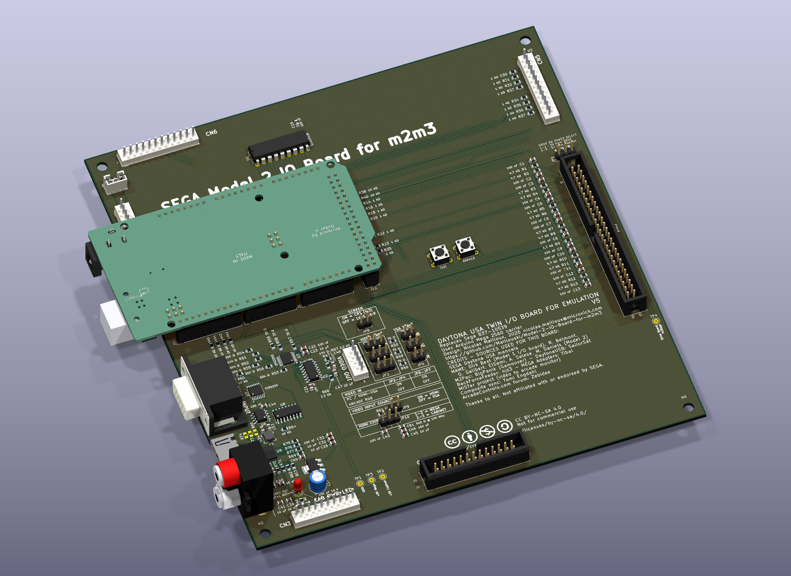
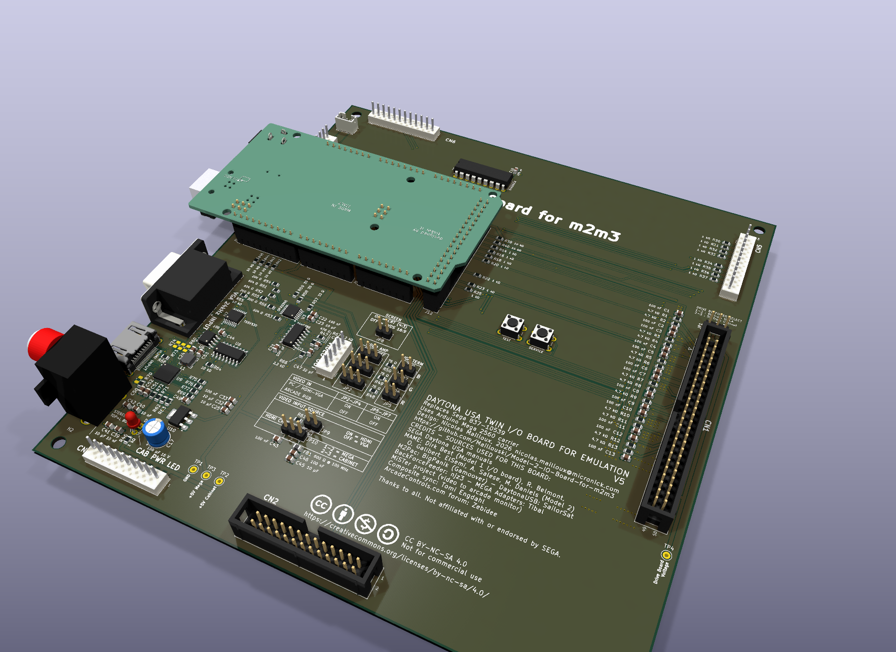
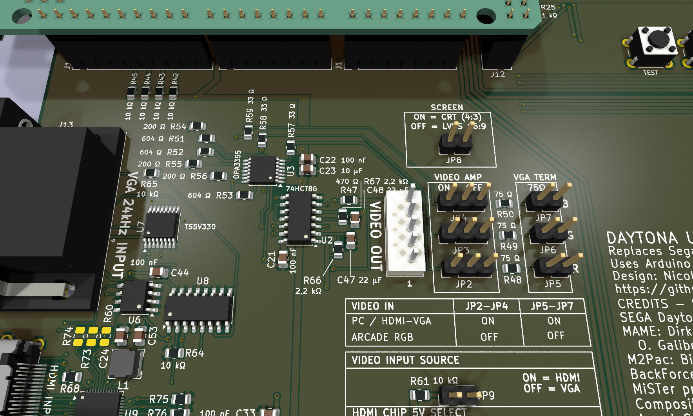
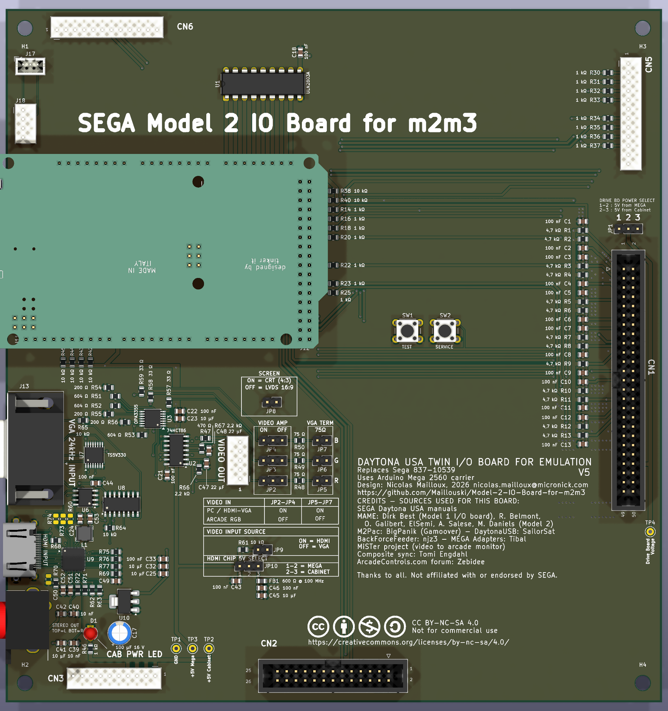
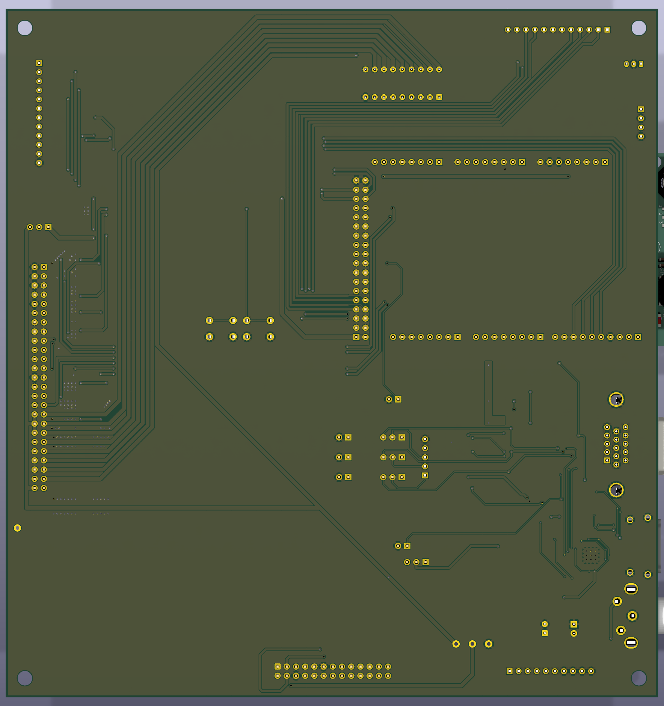

# M2 IO Emulator Board

[English](README.md) | **Français**

Carte de remplacement direct de la **carte E/S Sega 837-10539** de la borne **Daytona USA twin** (Sega Model 2), construite autour
d'un **Arduino Mega 2560**. Elle permet à un émulateur de piloter la borne d'origine : commandes, lampes, compteurs, drive board
d'origine (retour de force) et moniteur arcade d'origine.

> **État : prototype.** Le design passe la DRC et l'ERC, mais aucune carte n'a encore été fabriquée ni testée. Lire les
> [points ouverts](#points-ouverts) avant de commander.

**Version : V5** (2026-11-14). La V5 remplace le convertisseur HDMI → VGA de la V3 (CS5213, U4) par un **MS9292** (U9), lui ajoute un régulateur
3,3 V (U10) et ajoute deux connecteurs audio (J17, J18). La V3 avait ajouté l'[entrée HDMI](#entrée-hdmi), une sortie audio stéréo
et une [synchro composite](#synchro-composite) qui ne dépend plus de la polarité de H et V. L'état précédent (V3.2) est gardé sous l'étiquette
[`v3.2`](https://github.com/Maillouski/Model-2-IO-Board-for-m2m3/tree/v3.2), la V2 (cavalier d'écran JP8) sous l'étiquette [`v2`](https://github.com/Maillouski/Model-2-IO-Board-for-m2m3/tree/v2), et la V1, première carte, commandée chez JLCPCB le
2026-10-13, sous l'étiquette [`v1`](https://github.com/Maillouski/Model-2-IO-Board-for-m2m3/tree/v1).

## Ce qu'elle fait

L'idée est simple : on sort la carte E/S Sega de la borne et on met celle-ci à sa place. Elle a les mêmes dimensions, les mêmes
trous de fixation et les mêmes noms de connecteurs, donc le faisceau d'origine se branche directement. Rien n'est coupé ni
recâblé.

Une fois en place, l'Arduino Mega fait le pont entre l'émulateur et la borne. Il lit les commandes et pilote tout ce que la carte
d'origine pilotait :

- **Commandes** — volant, accélérateur, frein, levier de vitesses, monnayeur, START, boutons de vue VR, TEST et SERVICE.
- **Lampes, compteurs et relais** — commandés par un ULN2803A : les ampoules et les compteurs d'origine continuent de
  fonctionner.
- **Retour de force** — la drive board d'origine reste dans la borne et reçoit ses ordres du Mega : le volant garde son retour de force
  d'origine.
- **Vidéo** — une entrée HDMI (V3) ou une entrée VGA va au moniteur arcade d'origine, avec la synchro composite fabriquée sur la
  carte (négative, quelle que soit la polarité de H et V). Un petit ampli vidéo, activable par cavaliers, remonte le signal au niveau qu'attend le tube.
- **Son** — l'audio transporté par l'entrée HDMI sort sur deux prises RCA (J16). Une entrée séparée à 3 broches (J17) est reprise
  telle quelle sur une sortie à 4 broches (J18) vers le préampli de la borne.

Quelques détails pratiques facilitent la mise en route : boutons TEST et SERVICE directement sur la carte, DEL d'alimentation,
points de test pour chaque alimentation, et un cavalier (JP1) pour choisir si la logique de la drive board est alimentée par le
5 V du Mega ou par celui de la borne.

## Cavaliers vidéo

| VIDEO IN (J13) | JP2-JP4 (VIDEO AMP) | JP5-JP7 (VGA TERM 75 Ω) |
|---|---|---|
| PC / adaptateur HDMI-VGA | ON | ON |
| RGB arcade | OFF | OFF |

Le même tableau est imprimé sur la carte (en anglais). Avec l'entrée HDMI, prendre la première ligne : U9 est le même genre de puce que celle d'un adaptateur
HDMI → VGA (la V5 n'a pas encore été fabriquée, voir les [points ouverts](#points-ouverts)).

## Synchro composite

U2 (74HCT86) fabrique la synchro composite du moniteur à partir de H et V, d'après le circuit de
[Tomi Engdahl](https://www.epanorama.net/circuits/vga2rgbs.html), signalé par Zebidee sur le forum ArcadeControls.com. Chaque synchro est comparée (XOR) à sa propre moyenne, prise
par un filtre RC (R66 + C47 pour H, R67 + C48 pour V : 2,2 kΩ, 22 µF) : ses impulsions sortent donc toujours positives ; les
deux sont ensuite combinées puis inversées. Le résultat est une synchro composite **négative** quelle que soit la polarité de H
et V à l'entrée, ce qu'attend le moniteur d'origine. Après un changement de polarité (nouveau mode vidéo), les filtres se
stabilisent en une fraction de seconde. Elle part vers VIDEO OUT par R47 (470 Ω).

## Entrée HDMI

J15 reçoit directement la sortie HDMI de l'hôte ; U9 (Macrosilicon MS9292) la convertit en R/V/B analogique avec synchros
H/V et audio stéréo : plus besoin d'adaptateur HDMI → VGA externe. L'entrée VGA J13 reste, et un cavalier choisit entre les deux. La V3 utilisait
un CS5213 pour cette fonction ; la V5 prend le MS9292, car le CS5213 ne s'achète pas chez les distributeurs ordinaires.

| Cavalier | Position | Effet |
|---|---|---|
| JP9 (VIDEO INPUT SOURCE) | posé (ON) | vidéo de l'entrée HDMI (J15, par U9) |
| JP9 | retiré (OFF) | vidéo de l'entrée VGA (J13), comme en V2 |
| JP10 (HDMI CHIP 5V SELECT) | 1-2 | U9 et son régulateur 3,3 V alimentés par le 5 V du Mega |
| JP10 | 2-3 | alimentés par le 5 V de la borne, à travers une ferrite (FB1) |

- La commutation est faite par U7 (TS5V330, R/V/B) et U8 (74HCT157, synchros H/V) ; tout ce qui suit (ampli, synchro
  composite, VIDEO OUT) est identique à la V2.
- **Alimentation :** le MS9292 n'a aucune broche d'entrée 5 V. U10 (NCP1117ST33T3G) fait son 3,3 V à partir du 5 V de JP10 ; son 1,2 V vient
  d'un convertisseur abaisseur intégré à la puce, avec L1 (inductance de puissance 10 µH, Bourns SRN4018-100M). Le découplage suit le circuit de référence du fabricant (figure 3 de la fiche V1.5).
- **Niveau vidéo :** les sorties du DAC vont à la masse par R75-R77 (75 Ω), en parallèle avec la terminaison VGA R48-R50 (75 Ω, JP5-JP7) :
  le DAC voit 37,5 Ω. Sur une carte d'évaluation du MS9292, 75 Ω seuls faisaient saturer l'ampli vidéo.
- **Audio :** J16, double prise RCA superposée : **en haut = gauche**, **en bas = droite**, alimentée par le DAC de la puce à travers 470 Ω + 10 µF en série par
  canal. L'empreinte accepte une Same Sky RCJ-2223 (DigiKey ; rouge en haut, donc rouge = gauche) ou une Lian Xin
  XDJK-0271-1650 (LCSC C7527522 ; blanche en haut, rouge en bas). J17 (entrée AUDIO, JST PH 2,00 mm à 3 broches : 1 gauche, 2 masse, 3 droite) reçoit un
  câble droit depuis la sortie ligne de l'hôte et va tout droit à J18 (AUDIO OUT, JST NH 2,50 mm à 4 broches : 1 gauche, 2 masse, 3 droite, 4 masse) vers le
  préampli de la borne. Les deux chemins audio sont séparés : il n'y a pas de sélecteur.
- **Branchement à chaud :** la puce pilote elle-même la ligne HPD (sa sortie HDRXHPD). La résistance de tirage R60 de la V3 n'est pas posée.
- **EDID :** U6, une EEPROM AT24C02 sur les lignes DDC du HDMI (adresse 0x50, découplée par C24), est posée et arrive **vierge** ;
  les broches DDC de U9 ne sont pas reliées (R73 et R74, 0 Ω, ne sont pas posées). L'hôte doit y écrire un EDID de 256 octets (le mode vidéo du moniteur, et le son
  HDMI au besoin) : tant qu'elle est vierge, l'hôte lit un EDID invalide. Sa protection en écriture est à la masse : on la
  programme en place, par le câble HDMI.

## Cavalier d'écran (JP8)

Nouveau dans la V2. JP8 relie la broche D36 du Mega à la masse. Le Mega la lit avec son rappel interne et l'envoie à l'hôte avec
les autres entrées : l'hôte peut ainsi choisir son écran au démarrage. Une fois la carte dans la borne, changer d'écran ne
demande que le cavalier, pas de changement de logiciel.

| JP8 | Écran |
|---|---|
| posé (ON) | CRT (4:3) : le moniteur arcade d'origine, par l'entrée HDMI (V3) ou un adaptateur HDMI → VGA |
| retiré (OFF) | écran LVDS (16:9) |

Imprimé sur la carte (en anglais) : SCREEN / ON = CRT (4:3) / OFF = LVDS 16:9. Ce que l'hôte fait de cette entrée dépend de son
logiciel (voir [Piloter la carte depuis un ordinateur](#piloter-la-carte-depuis-un-ordinateur)).

## Piloter la carte depuis un ordinateur

La carte est fournie avec le programme de son Arduino Mega ([`firmware/`](firmware/m2io-mega)) et une console d'essai
([`tools/m2io_console.py`](tools/m2io_console.py)). Pour faire tourner Daytona USA sur votre propre ordinateur ou votre
compilation d'un émulateur et atteindre la borne par cette carte, lisez **[Piloter la carte depuis son propre
hôte](docs/HOST-PROTOCOL.fr.md)** : liaison série, trames, contenu des octets, branchement sur la carte E/S émulée de MAME
et pièges à éviter.

## Vues 3D

Rendus KiCad 10 tirés des fichiers de ce dépôt.

| | |
|---|---|
|  |  |
| Vue en perspective | Section vidéo : entrées VGA et HDMI, choix de source, ampli OPA3355, cavaliers et tableaux de réglage |
|  |  |
| Dessus | Dessous |

## Contenu du dépôt

| Chemin | Contenu |
|---|---|
| `kicad/` | projet KiCad 10 : schéma, PCB, règles de conception, librairie d'empreintes du projet (`interface-borne.pretty`), modèles 3D |
| `fabrication/` | Gerbers, fichiers de perçage Excellon et leurs plans (`gerbers/`), les mêmes fichiers en zip pour le fabricant, fichier de placement ; BOM et CPL JLCPCB pour l'assemblage des CMS ([`jlcpcb/`](fabrication/jlcpcb/README.fr.md)) |
| `firmware/` | programme de l'Arduino Mega (`m2io-mega/`) et son essai sur PC, sans Mega (`test/`) |
| `tools/` | console d'essai : joue le rôle de l'hôte depuis n'importe quel ordinateur (Python 3 + pyserial) |
| `bom/` | BOM complète ([`BOM.fr.md`](bom/BOM.fr.md), [English](bom/BOM.md)) et fichier d'import DigiKey ([`BOM-digikey.csv`](bom/BOM-digikey.csv)) |
| `docs/` | [protocole de l'hôte](docs/HOST-PROTOCOL.fr.md), schéma en PDF, rendus de la carte |

Carte : 2 couches, 180 × 190 mm. Les Gerbers sortent des réglages de tracé enregistrés dans le PCB (KiCad 10).

## Points ouverts

- **La V5 n'a pas été fabriquée.** Le circuit du MS9292 suit le schéma de référence du fabricant ; les niveaux vidéo ont été mesurés sur une
  carte d'évaluation du MS9292, pas sur cette carte. Son comportement avec le mode 24 kHz du moniteur arcade, sur cette carte, n'est pas vérifié,
  et les paires HDMI passent sur une carte 2 couches sans impédance contrôlée. La V1 est la seule carte commandée.
- **La pastille centrale de U9 est reliée à la masse**, ce que la fiche n'écrit pas ; vérifier la continuité (pastille vers broche 17) sur les premières puces. La pastille
  a 9 vias : commander des vias « Epoxy Filled & Capped » ou réduire la pâte.
- **Vias et pistes fins :** le bloc HDMI utilise des pistes de 0,15 mm et des vias jusqu'à 0,45 / 0,20 mm (27 vias font 0,45 / 0,20 mm, pile à la
  taille que JLCPCB surtaxe) ; le reste de la carte garde des pistes de 0,2 mm et des vias de 0,6 / 0,3 mm. À confirmer au devis du fabricant.
- **CN1 et CN2** sont des embases 3M simples à quatre murs, sans leviers d'éjection.

## Modèles 3D

Le modèle de l'Arduino Mega dans `kicad/3d/` est dérivé des fichiers CAO d'Arduino (CC BY-SA 4.0) et de modèles de la
bibliothèque KiCad ; voir [`kicad/3d/README.fr.md`](kicad/3d/README.fr.md). Les connecteurs JST NH et la prise RCA (J16,
dessinée comme la RCJ-2223) utilisent des modèles simplifiés faits pour ce projet.

## Crédits

Sources utilisées pour cette carte : manuels SEGA de Daytona USA ; MAME (Dirk Best pour la carte E/S Model 1 ; R. Belmont,
O. Galibert, ElSemi, A. Salese, M. Daniels pour le Model 2) ; M2Pac de BigPanik (Gamoover) ; DaytonaUSB de SailorSat ;
BackForceFeeder de njz3 ; adaptateurs MEGA de Tibal ; le projet MiSTer (vidéo vers moniteur arcade) ; Tomi Engdahl (circuit de synchro composite) ; Zebidee sur le forum ArcadeControls.com.

Projet non affilié à SEGA ni approuvé par SEGA.

## Licence

© 2026 Nicolas Mailloux. **CC BY-NC-SA 4.0** — voir [`LICENSE`](LICENSE) (texte officiel en anglais).
Vous pouvez fabriquer, utiliser, modifier et partager cette carte, à condition de citer l'auteur, de garder les crédits et de
partager vos modifications sous la même licence. **Aucun usage commercial** : ne vendez ni la carte, ni les fichiers, ni un dérivé.
Le firmware et les outils sont sous la même licence.
