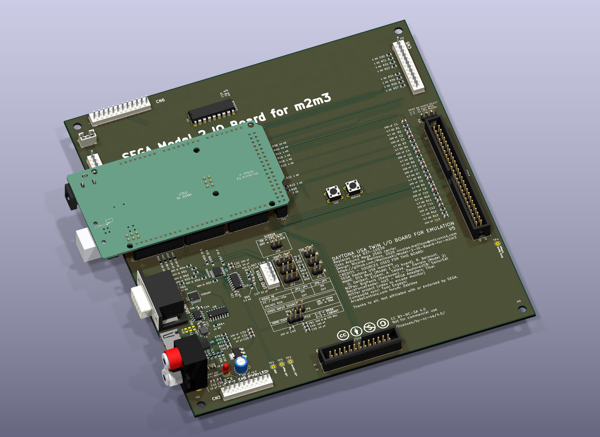
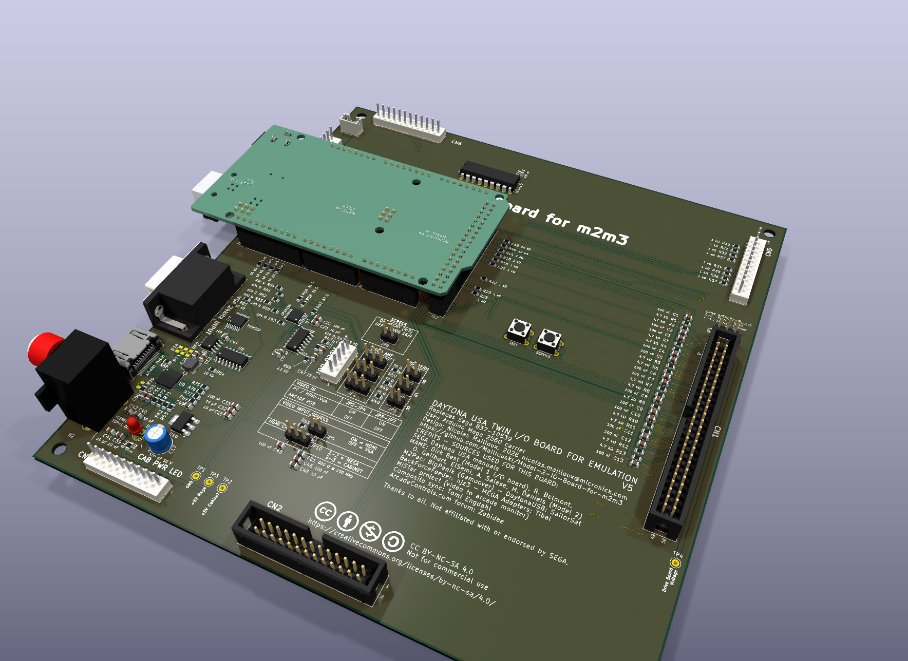
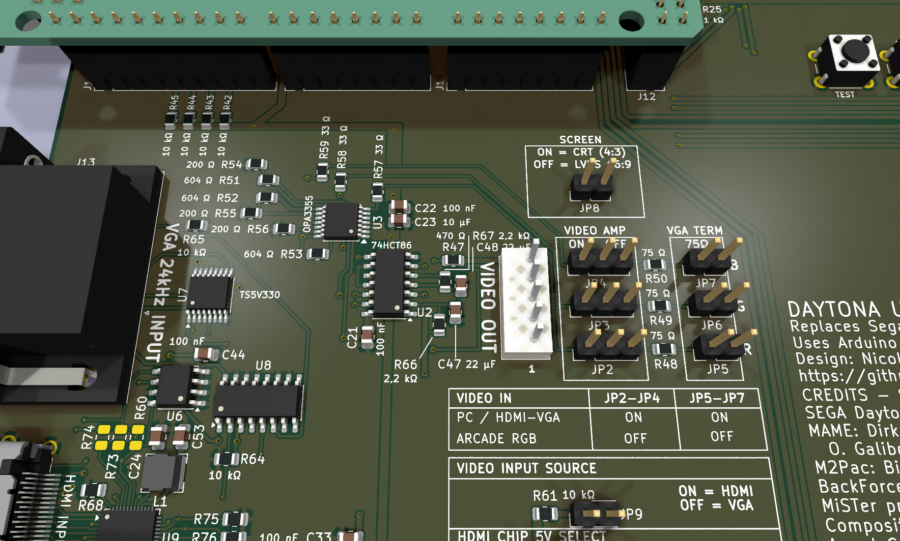
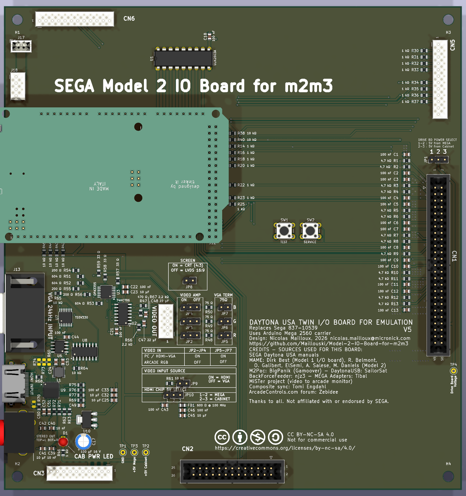
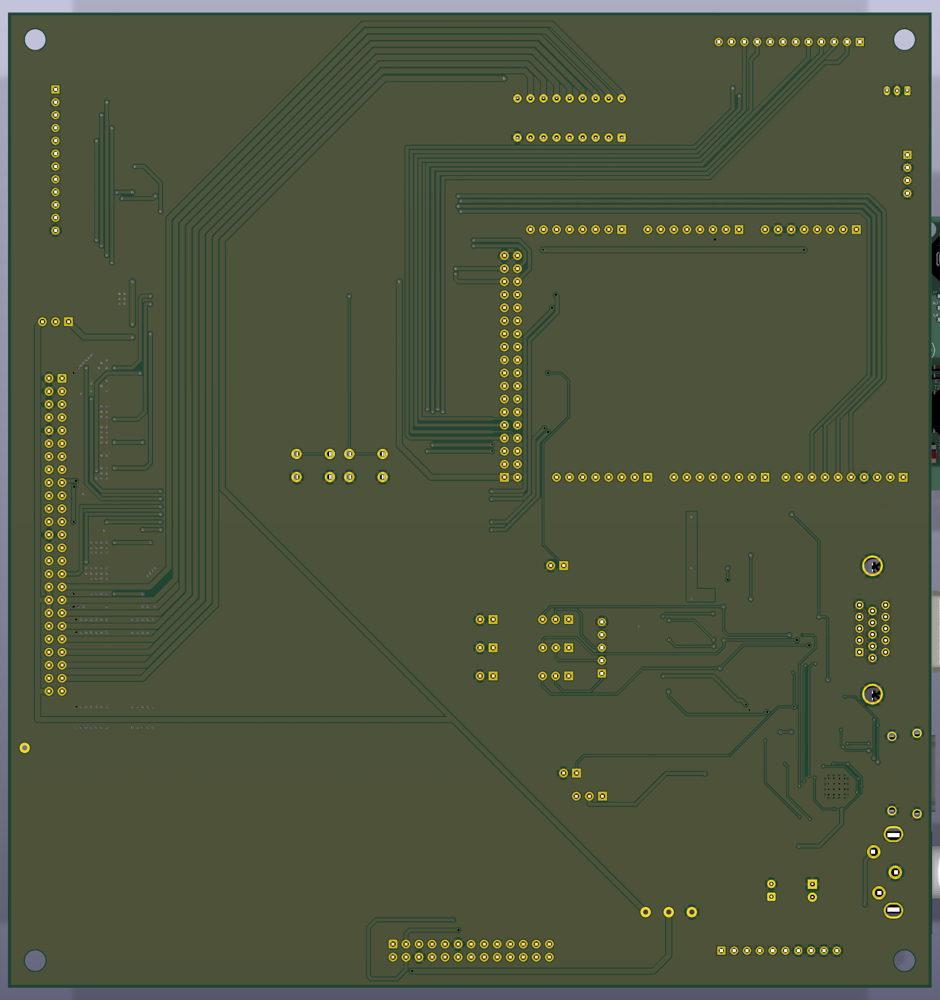

# M2 IO Emulator Board

**English** | [Français](README.fr.md)

A drop-in replacement for the **Sega 837-10539 I/O board** of the **Daytona USA twin** cabinet (Sega Model 2), built around an
**Arduino Mega 2560**. It lets an emulator drive the original cabinet: controls, lamps, meters, the original drive board (force
feedback) and the original arcade monitor.

> **Status: prototype.** The design passes DRC and ERC, but no board has been built or tested yet. Read
> [Open points](#open-points) before you order.

**Version: V5** (2026-11-14). V5 replaces the HDMI → VGA converter of V3 (CS5213, U4) with an **MS9292** (U9), adds a 3.3 V
regulator for it (U10), and adds two audio connectors (J17, J18). V3 added the [HDMI input](#hdmi-input), a stereo audio output
and a [composite sync](#composite-sync) that no longer depends on the polarity of H and V. The previous state (V3.2) is kept under the tag
[`v3.2`](https://github.com/Maillouski/Model-2-IO-Board-for-m2m3/tree/v3.2), V2 (screen jumper JP8) under the tag [`v2`](https://github.com/Maillouski/Model-2-IO-Board-for-m2m3/tree/v2), and V1,
the first board, ordered from JLCPCB on 2026-10-13, under the tag [`v1`](https://github.com/Maillouski/Model-2-IO-Board-for-m2m3/tree/v1).

## What it does

The idea is simple: pull the Sega I/O board out of the cabinet and put this one in its place. It has the same size, the same
mounting holes and the same connector names, so the original harness plugs straight in. Nothing gets cut or rewired.

Once it's in, the Arduino Mega becomes the bridge between the emulator and the cabinet. It reads the controls and drives
everything the original board used to drive:

- **Controls** — steering, accelerator, brake, shifter, coin, START, the VR view buttons, TEST and SERVICE.
- **Lamps, meters and relay** — switched by a ULN2803A, so the original bulbs and coin meters keep working.
- **Force feedback** — the original drive board stays in the cabinet and gets its commands from the Mega, so the wheel keeps
  its original force feedback.
- **Video** — an HDMI input (V3) or a VGA input goes to the original arcade monitor, with composite sync built on the board
  (negative, whatever the H/V polarity). A small switchable video amplifier lifts the signal to the level the tube expects.
- **Sound** — the audio carried by the HDMI input comes out on two RCA jacks (J16). A separate 3-pin input (J17) is passed straight
  through to a 4-pin output (J18) for the cabinet's preamp.

A few practical details make bring-up easier: TEST and SERVICE buttons right on the board, a power LED, test points for each
supply, and a jumper (JP1) to choose whether the drive board logic runs from the Mega's 5 V or from the cabinet's.

## Video jumpers

| VIDEO IN (J13) | JP2-JP4 (VIDEO AMP) | JP5-JP7 (VGA TERM 75 Ω) |
|---|---|---|
| PC / HDMI-VGA adapter | ON | ON |
| Arcade RGB | OFF | OFF |

The same table is printed on the board. With the HDMI input, use the first row: U9 is the same kind of chip as the one inside an HDMI-to-VGA
adapter (V5 has not been built yet, see [Open points](#open-points)).

## Composite sync

U2 (74HCT86) builds the composite sync for the monitor from H and V, after the circuit of
[Tomi Engdahl](https://www.epanorama.net/circuits/vga2rgbs.html), pointed out by Zebidee on the ArcadeControls.com forum. Each sync is compared (XOR) with its own average, taken by an
RC filter (R66 + C47 for H, R67 + C48 for V: 2.2 kΩ, 22 µF), so its pulses always come out positive; the two are then combined
and inverted. The result is a **negative** composite sync whatever the polarity of H and V at the input, which is what the
original monitor expects. After a change of polarity (new video mode), the filters settle within a fraction of a second. It
goes to VIDEO OUT through R47 (470 Ω).

## HDMI input

J15 takes the host's HDMI output directly; U9 (Macrosilicon MS9292) turns it into analog R/G/B with H/V sync and stereo audio, so
no external HDMI → VGA adapter is needed. The VGA input J13 is still there, and a jumper chooses between the two. V3 used a CS5213
for this job; V5 uses the MS9292 because the CS5213 cannot be bought from regular distributors.

| Jumper | Setting | Effect |
|---|---|---|
| JP9 (VIDEO INPUT SOURCE) | ON | video from the HDMI input (J15, through U9) |
| JP9 | OFF | video from the VGA input (J13), as on V2 |
| JP10 (HDMI CHIP 5V SELECT) | 1-2 | U9 and its 3.3 V regulator run from the Mega's 5 V |
| JP10 | 2-3 | they run from the cabinet's 5 V, through a ferrite filter (FB1) |

- The switch is made by U7 (TS5V330, R/G/B) and U8 (74HCT157, H/V sync); everything after it (amplifier, composite sync, VIDEO
  OUT) is the same as on V2.
- **Power:** the MS9292 has no 5 V input pin. U10 (NCP1117ST33T3G) makes its 3.3 V from the 5 V of JP10; its 1.2 V comes from a
  buck converter inside the chip with L1 (10 µH power inductor, Bourns SRN4018-100M). Decoupling follows the maker's reference circuit (figure 3 of datasheet V1.5).
- **Video level:** the DAC outputs go to ground through R75-R77 (75 Ω), in parallel with the VGA termination R48-R50 (75 Ω, JP5-JP7), so
  the DAC sees 37.5 Ω. On an MS9292 evaluation board, 75 Ω alone made the video amplifier saturate.
- **Audio:** J16, a stacked RCA jack: **top = left**, **bottom = right**, fed by the chip's DAC through 470 Ω + 10 µF in series per
  channel. The footprint takes a Same Sky RCJ-2223 (DigiKey; red on top, so red = left) or a Lian Xin XDJK-0271-1650 (LCSC C7527522;
  white on top, red at the bottom). J17 (AUDIO input, 3-pin JST PH 2.00 mm: 1 left, 2 ground, 3 right) takes a straight cable from
  the host's line output and goes straight to J18 (AUDIO OUT, 4-pin JST NH 2.50 mm: 1 left, 2 ground, 3 right, 4 ground) for the
  cabinet's preamp. The two audio paths are separate: there is no selector.
- **Hot plug:** the chip drives the HPD line itself (its HDRXHPD output). The V3 pull-up R60 is not fitted.
- **EDID:** U6, an AT24C02 EEPROM on the HDMI DDC lines (address 0x50, decoupled by C24), is fitted and comes **blank**; U9's own
  DDC pins are not connected (R73 and R74, 0 Ω, are not fitted). The host must write a 256-byte EDID into it (the monitor's video mode, and HDMI audio if wanted):
  while it is blank, the host reads an invalid EDID. Its write protect is tied low, so it is programmed in place, through the
  HDMI cable.

## Screen jumper (JP8)

New in V2. JP8 ties the Mega's D36 pin to ground. The Mega reads it with its internal pull-up and sends it to the host with the
other inputs, so the host can choose its screen at start-up. Once the board is in the cabinet, switching screens only takes the
jumper, not a software change.

| JP8 | Screen |
|---|---|
| ON | CRT (4:3): the original arcade monitor, through the HDMI input (V3) or an HDMI-to-VGA adapter |
| OFF | LVDS panel (16:9) |

Printed on the board as SCREEN / ON = CRT (4:3) / OFF = LVDS 16:9. What the host does with this input is up to the host
software (see [Driving it from a computer](#driving-it-from-a-computer)).

## Driving it from a computer

The board comes with its Arduino Mega program ([`firmware/`](firmware/m2io-mega)) and a test console
([`tools/m2io_console.py`](tools/m2io_console.py)). To run Daytona USA on your own computer or emulator build and reach the
cabinet through this board, read **[Driving the board from your own host](docs/HOST-PROTOCOL.md)**: serial link, frames,
byte meanings, how to connect them to MAME's emulated I/O board, and the pitfalls to avoid.

## 3D views

Rendered with KiCad 10 from the files in this repository.

| | |
|---|---|
|  |  |
| Perspective view | Video section: VGA and HDMI inputs, source switch, OPA3355 amplifier, jumpers and settings tables |
|  |  |
| Top | Bottom |

## Repository

| Path | Contents |
|---|---|
| `kicad/` | KiCad 10 project: schematic, PCB, design rules, project footprint library (`interface-borne.pretty`), 3D models |
| `fabrication/` | Gerbers, Excellon drill files and drill maps (`gerbers/`), the same files zipped for the fab, pick-and-place file; JLCPCB BOM and CPL for SMD assembly ([`jlcpcb/`](fabrication/jlcpcb/README.md)) |
| `firmware/` | Arduino Mega program (`m2io-mega/`) and its PC test without a Mega (`test/`) |
| `tools/` | Test console: plays the host's part from any computer (Python 3 + pyserial) |
| `bom/` | Full BOM ([`BOM.md`](bom/BOM.md)) and DigiKey import file ([`BOM-digikey.csv`](bom/BOM-digikey.csv)) |
| `docs/` | [Host protocol](docs/HOST-PROTOCOL.md), schematic PDF, board renders |

Board: 2 layers, 180 × 190 mm. Gerbers come from the PCB's own plot settings (KiCad 10).

## Open points

- **V5 has not been built.** The MS9292 circuit follows the maker's reference design; the video levels were measured on an MS9292
  evaluation board, not on this board. Its behaviour with the 24 kHz mode of the arcade monitor on this board is not verified,
  and the HDMI pairs run on a 2-layer board without controlled impedance. V1 is the only board that has been ordered.
- **U9's exposed pad is tied to ground**, which the datasheet does not state; check continuity (pad to pin 17) on the first chips. The pad
  has 16 vias: order "Epoxy Filled & Capped" vias or reduce the paste.
- **Fine vias and tracks:** the HDMI block uses 0.15 mm tracks and vias down to 0.45 / 0.20 mm (27 vias are 0.45 / 0.20 mm,
  right at the size JLCPCB surcharges); the rest of the board keeps 0.2 mm tracks and 0.6 / 0.3 mm vias. Confirm with the fabricator's quote.
- **CN1 and CN2** are plain 3M four-wall headers, without ejector latches.

## 3D models

The Arduino Mega model in `kicad/3d/` is derived from Arduino's CAD files (CC BY-SA 4.0) and KiCad library models; see
[`kicad/3d/README.md`](kicad/3d/README.md). The JST NH connectors and the RCA jack (J16, drawn as the RCJ-2223) use simplified models made for this project; U9, L1, U10 and J17 use the standard KiCad models.

## Credits

Sources used for this board: SEGA Daytona USA manuals; MAME (Dirk Best for the Model 1 I/O board; R. Belmont, O. Galibert,
ElSemi, A. Salese, M. Daniels for Model 2); M2Pac by BigPanik (Gamoover); DaytonaUSB by SailorSat; BackForceFeeder by njz3; MEGA
adapters by Tibal; the MiSTer project (video to arcade monitor); Tomi Engdahl (composite sync circuit); Zebidee on the ArcadeControls.com forum.

Not affiliated with or endorsed by SEGA.

## License

© 2026 Nicolas Mailloux. **CC BY-NC-SA 4.0** — see [`LICENSE`](LICENSE).
You may build, use, modify and share this board, as long as you credit the author, keep the credits, and share changes under the
same license. **No commercial use**: don't sell the board, the files or a derivative.
The firmware and the tools are under the same license.
